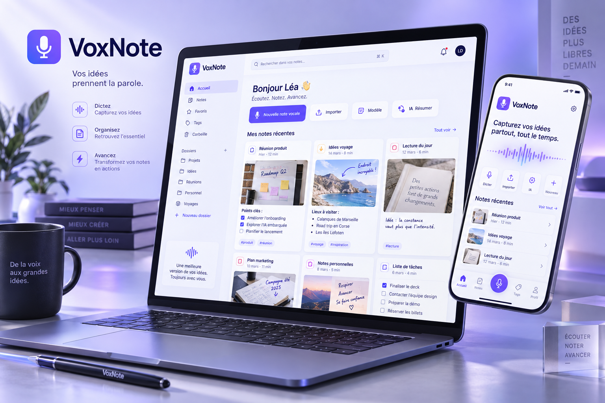
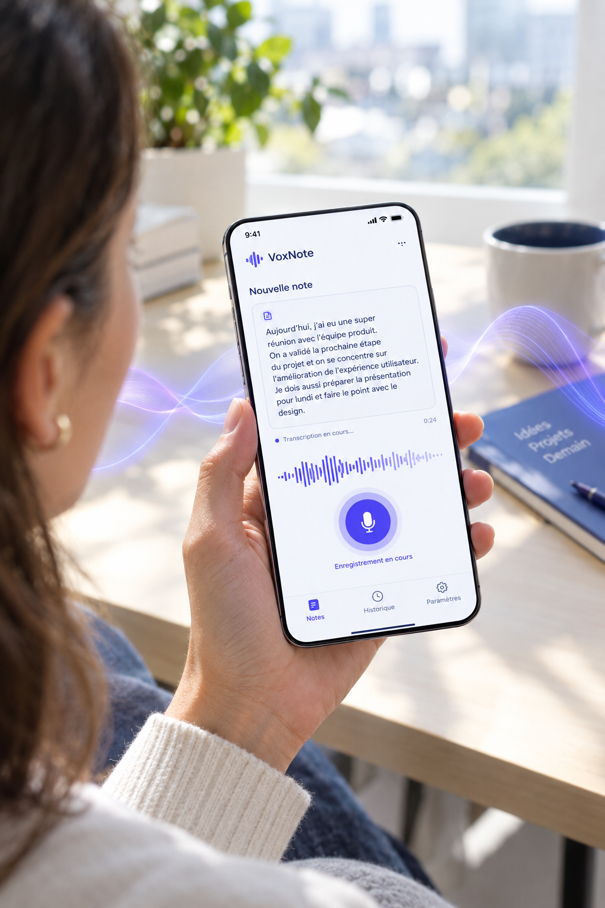

# VoxNote 🎙️📸📱

**VoxNote** est une application web et mobile (**Progressive Web App — PWA**) de prise de notes multimodale développée avec **React.js (Vite)**, **Tailwind CSS** et **Supabase**. Elle permet de capturer, d'organiser, d'illustrer et de partager ses notes au **clavier**, à la **voix en temps réel** et en **photos annotées**, avec une isolation stricte des données par utilisateur grâce aux politiques **Row Level Security (RLS)**.

<p align="center">
  
</p>

<p align="center">
  
  <br />
  <em>Dictée vocale en direct et transcription instantanée sur mobile</em>
</p>

---

## ✨ Fonctionnalités principales

### 1. Authentification distincte & connexion directe Supabase
- Deux parcours séparés et adaptés :
  - **Connexion** : e-mail + mot de passe avec accès immédiat au tableau de bord.
  - **Inscription** : nom complet, e-mail, indicateur visuel de robustesse du mot de passe et confirmation du mot de passe.
- Vérification automatique de la disponibilité du service **Supabase Auth** et gestion claire des retours d'état (confirmation d'e-mail, identifiants invalides, session persistante).

### 2. Dictée vocale en direct (Web Speech API)
- Transcription vocale continue en français (`fr-FR`) via l'API native du navigateur (`SpeechRecognition` / `webkitSpeechRecognition`) sans service tiers payant.
- Aperçu instantané des phrases en cours de prononciation avant insertion dans le contenu de la note.
- Protection intégrée contre la duplication des segments vocaux sur **Google Chrome Android**.

### 3. Prise de photos & notes visuelles annotées
- **Caméra intégrée** (`navigator.mediaDevices.getUserMedia`) avec bascule caméra arrière / avant sur smartphone et ordinateur, ou **import d'images** depuis la galerie.
- **Compression automatique côté client** via HTML5 `<canvas>` (JPEG optimisé jusqu'à `1600 px`) pour accélérer l'envoi mobile et économiser le stockage.
- Ajout d'une **note / légende dédiée sous chaque photo**, saisissable au clavier ou **dictée directement à la voix**.
- **Visionneuse plein écran (Lightbox)** avec navigation entre les clichés d'une même note.

### 4. Gestion complète des notes (CRUD) & Recherche
- **Création, lecture, modification et suppression** de notes synchronisées avec PostgreSQL (`public.notes`) et Supabase Storage (`note-photos`).
- Barre de **recherche instantanée** (dans le titre, le contenu et les légendes des photos) et filtres rapides (**Toutes** / **Avec photos**).
- Nettoyage automatique dans Supabase Storage des photos supprimées lors de l'édition ou de la suppression d'une note.

### 5. Partage direct sur WhatsApp
- Formatage automatique du message aux conventions WhatsApp (`*Titre en gras*`, texte structuré, légendes numérotées des photos et liens temporaires signés).
- Envoi en 1 clic vers **WhatsApp mobile ou WhatsApp Web** (`wa.me`), avec saisie optionnelle du numéro du destinataire ou sélection directe dans les contacts WhatsApp.
- Sur mobile compatible (**Web Share API Level 2**), envoi simultané des **fichiers photo en pièces jointes** avec le texte de la note.

### 6. Application Mobile PWA (Android & iOS)
- Expérience mobile dédiée avec **barre de navigation basse à 4 accès rapides** : *Mes notes*, *Écrire*, *Dicter* et *Photo*.
- **Raccourcis d'écran d'accueil** (`/?action=new`, `/?action=camera`, `/?action=voice`) accessibles par appui long sur l'icône de l'application installée.
- **Service Worker (`voxnote-pwa-v2`)** assurant la mise en cache résiliente de l'interface (App Shell) tout en laissant passer en direct les appels sécurisés vers Supabase.
- **Détection des navigateurs intégrés** (WhatsApp, Facebook, Instagram) avec bouton d'ouverture directe dans **Google Chrome** sur Android pour débloquer l'installation système.

---

## 🛠️ Stack technique

| Couche | Technologies utilisées |
| :--- | :--- |
| **Frontend** | React 19, Vite 8, JavaScript (ES Modules) |
| **Interface & Design** | Tailwind CSS v4 (`@tailwindcss/vite`), Lucide React Icons |
| **Reconnaissance vocale** | Web Speech API native (`SpeechRecognition` / `webkitSpeechRecognition`) |
| **Caméra & Traitement d'image** | MediaDevices API (`getUserMedia`) + compression JPEG HTML5 `<canvas>` |
| **Partage externe** | Protocole WhatsApp `https://wa.me/` + Web Share API (`navigator.share` avec `File`) |
| **Backend, Auth & Base de données** | Supabase (`@supabase/supabase-js` v2), PostgreSQL, Row Level Security (RLS) |
| **Stockage de fichiers** | Supabase Storage — bucket privé `note-photos` avec URLs signées (`createSignedUrls`) |
| **PWA & Déploiement** | Web App Manifest (`manifest.json`), Service Worker (`sw.js`), Netlify (`netlify.toml`) |

---

## 📂 Architecture du projet

```text
VoxNote/
├── public/
│   ├── favicon.svg                  # Icône vectorielle de l'application
│   ├── manifest.json                # Web App Manifest principal (icônes any/maskable + raccourcis)
│   ├── manifest.webmanifest         # Miroir du manifeste PWA
│   ├── sw.js                        # Service Worker (cache App Shell voxnote-pwa-v2)
│   └── icons/                       # Jeu d'icônes PNG (32x32, 180x180 Apple, 192x192, 512x512, maskable)
├── src/
│   ├── components/
│   │   ├── AuthForm.jsx             # Écrans séparés de Connexion et d'Inscription Supabase
│   │   ├── CameraCaptureModal.jsx   # Capture photo caméra / galerie + légende vocale ou clavier
│   │   ├── InstallPwaModal.jsx      # Guide & déclencheur d'installation mobile Android / iOS
│   │   ├── NotesDashboard.jsx       # Tableau de bord CRUD, éditeur vocal/photo & barre mobile
│   │   ├── PhotoLightboxModal.jsx   # Visionneuse photo plein écran
│   │   ├── SupabaseSetupModal.jsx   # Aide et script SQL de configuration Supabase
│   │   └── WhatsAppShareModal.jsx   # Modale d'aperçu et d'envoi WhatsApp (texte + photos)
│   ├── hooks/
│   │   ├── usePwaInstall.js         # Détection PWA, WebView, hors-ligne et prompt d'installation
│   │   └── useSpeechRecognition.js  # Hook de dictée vocale continue (Web Speech API)
│   ├── lib/
│   │   └── supabaseClient.js        # Initialisation du client Supabase
│   ├── services/
│   │   └── notesService.js          # Opérations CRUD PostgreSQL + upload/suppression Supabase Storage
│   ├── utils/
│   │   ├── imageUtils.js            # Redimensionnement et compression JPEG côté client
│   │   └── whatsappUtils.js         # Formatage WhatsApp, liens wa.me et partage de fichiers natif
│   ├── App.jsx                      # Gestion de la session utilisateur et routage principal
│   ├── index.css                    # Configuration Tailwind CSS v4 & zones sûres mobiles (safe-area)
│   └── main.jsx                     # Point d'entrée React, ErrorBoundary & enregistrement du SW
├── supabase/
│   └── schema.sql                   # Script SQL complet : table notes, bucket note-photos & règles RLS
├── visuels/
│   ├── 01-voxnote-banniere-hero.png # Bannière de présentation Web & Mobile
│   └── 02-voxnote-dictee-vocale.png # Aperçu mobile de la dictée vocale en direct
├── .env.example                     # Modèle des variables d'environnement Supabase
├── index.html                       # Entrée HTML PWA, métadonnées mobiles & capture beforeinstallprompt
├── netlify.toml                     # Configuration de build, redirections SPA et en-têtes HTTP Netlify
├── package.json                     # Dépendances et scripts NPM
└── vite.config.js                   # Configuration Vite + Tailwind CSS
```

---

## 🚀 Installation et lancement en local

### Prérequis
- **Node.js** `>= 20` (recommandé : Node.js `22`) et **npm**
- Un projet **Supabase** actif
- Un navigateur moderne supportant la **Web Speech API** pour la dictée vocale (**Google Chrome**, **Microsoft Edge** ou **Safari**)

### Étapes
1. **Cloner le dépôt et installer les dépendances** :
   ```bash
   git clone https://github.com/Bervellearnaud/VoxNote.git
   cd VoxNote
   npm install
   ```

2. **Configurer les variables d'environnement** :
   ```bash
   cp .env.example .env
   ```
   Renseignez vos clés dans le fichier `.env` (*Supabase Dashboard → Project Settings → API*) :
   ```env
   VITE_SUPABASE_URL=https://votre-projet-id.supabase.co
   VITE_SUPABASE_ANON_KEY=votre-cle-publique-anon-supabase
   ```

3. **Lancer le serveur de développement** :
   ```bash
   npm run dev
   ```
   L'application est accessible sur `http://localhost:5173`.

4. **Compiler pour la production** :
   ```bash
   npm run build
   npm run preview
   ```

---

## 🗄️ Configuration Supabase (Base de données, Storage & RLS)

Toute l'infrastructure backend se configure en **une seule exécution SQL** :

1. Ouvrez votre tableau de bord **Supabase** → **SQL Editor** → **New query**.
2. Copiez-collez l'intégralité du fichier [`supabase/schema.sql`](./supabase/schema.sql) puis cliquez sur **Run**.

Ce script met automatiquement en place :
- **La table `public.notes`** (`id`, `user_id`, `title`, `content`, `photos` en `JSONB`, `created_at`, `updated_at`) avec index sur `(user_id, updated_at DESC)` et trigger automatique de mise à jour de `updated_at`.
- **Les 4 politiques RLS sur `public.notes`** (`SELECT`, `INSERT`, `UPDATE`, `DELETE`) vérifiant `auth.uid() = user_id` pour garantir qu'un utilisateur n'accède strictement qu'à ses propres notes.
- **Le bucket privé `note-photos`** dans **Supabase Storage** (limite de `5 Mo` par image, formats `image/jpeg`, `image/png`, `image/webp`).
- **Les 4 politiques RLS sur `storage.objects`** cloisonnant chaque utilisateur dans son dossier personnel `{auth.uid()}/{photo_id}.jpg`.

> **Authentification Email** : dans *Supabase Dashboard → Authentication → Providers → Email*, vérifiez que **Enable Email provider** est activé. Pour autoriser la connexion immédiate dès l'inscription sans validation d'e-mail préalable, désactivez *Confirm email*.

---

## 🌐 Déploiement sur Netlify

Le fichier [`netlify.toml`](./netlify.toml) configure nativement le déploiement :
- **Commande de build** : `npm run build`
- **Dossier publié** : `dist`
- **Version Node.js** : `22`
- **Redirection SPA** : `/* -> /index.html` (`200`)
- **En-têtes de sécurité & PWA** :
  - `Permissions-Policy: camera=(self), microphone=(self)` pour autoriser la dictée vocale et la prise de photos en HTTPS.
  - `Content-Type: application/manifest+json` et contrôle du cache sur `/manifest.json`, `/manifest.webmanifest` et `/sw.js`.

Dans **Netlify → Site configuration → Environment variables**, définissez :
- `VITE_SUPABASE_URL`
- `VITE_SUPABASE_ANON_KEY`

---

## 📲 Installer VoxNote sur mobile (PWA)

Une fois l'application ouverte en **HTTPS** sur votre smartphone :

- **Sur Android (Google Chrome)** :
  1. Ouvrez le lien directement dans **Google Chrome** *(si le lien a été reçu sur WhatsApp, appuyez sur le bouton orange **« Ouvrir directement dans Google Chrome »** ou sur `⋮ → Ouvrir dans Chrome`)*.
  2. Appuyez sur le bouton **« Télécharger l'application mobile »** / **« Appli »** dans VoxNote, ou ouvrez le menu **`⋮` → Ajouter à l'écran d'accueil → Installer**.
- **Sur iPhone / iPad (Safari)** :
  1. Ouvrez le lien dans **Safari**.
  2. Appuyez sur l'icône **Partager** (`⬆️`) en bas de l'écran, puis choisissez **« Sur l'écran d'accueil »** (`➕`) et validez par **Ajouter**.

---

## 📜 Scripts NPM disponibles

| Commande | Description |
| :--- | :--- |
| `npm run dev` | Démarre le serveur de développement Vite avec rechargement à chaud (HMR) |
| `npm run build` | Génère le bundle de production optimisé dans le dossier `dist/` |
| `npm run preview` | Prévisualise localement la version compilée de production |
